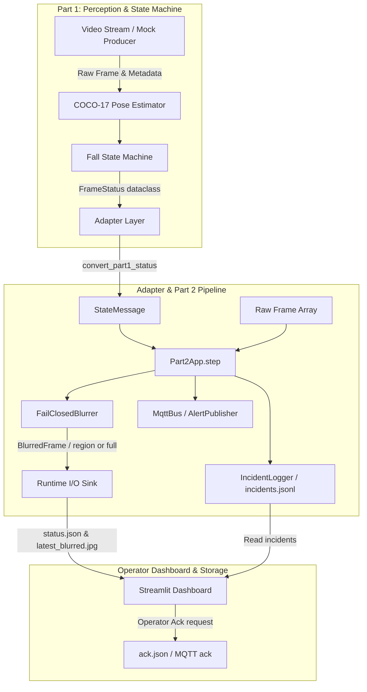

# CRAFTIFAI: FallGuard AI

> **Privacy-Protected Assistive Fall Monitoring Pipeline & Operator Dashboard**

[](https://www.python.org/)
[](https://streamlit.io/)
[](LICENSE)
[](#limitations)

---

## Table of Contents

1. [Project Overview](#1-project-overview)
2. [Problem Statement & Motivation](#2-problem-statement--motivation)
3. [Key Features](#3-key-features)
4. [System Architecture & Data Flow](#4-system-architecture--data-flow)
5. [Technology Stack](#5-technology-stack)
6. [Repository Folder Structure](#6-repository-folder-structure)
7. [Prerequisites & System Requirements](#7-prerequisites--system-requirements)
8. [Installation & Setup Instructions](#8-installation--setup-instructions)
9. [Running the Integration Simulation](#9-running-the-integration-simulation)
10. [Launching the Operator Dashboard](#10-launching-the-operator-dashboard)
11. [Running Test Suites](#11-running-test-suites)
12. [Privacy-Preserving Image Processing & Fail-Closed Behavior](#12-privacy-preserving-image-processing--fail-closed-behavior)
13. [Incident Logging & Acknowledgement Workflow](#13-incident-logging--acknowledgement-workflow)
14. [Example Incident Output](#14-example-incident-output)
15. [Privacy Audit & Verified Test Results](#15-privacy-audit--verified-test-results)
16. [Current Limitations & Future Improvements](#16-current-limitations--future-improvements)
17. [Troubleshooting Common Setup Errors](#17-troubleshooting-common-setup-errors)
18. [Medical Disclaimer](#18-medical-disclaimer)

---

## 1. Project Overview

**CRAFTIFAI FallGuard AI** is an advanced, privacy-first computer vision and operator monitoring pipeline designed to detect falls in residential and assisted living environments. Built around a robust **5-state temporal fall state machine** and a **fail-closed privacy blur architecture**, FallGuard processes video feeds to identify fall events while strictly preventing the exposure or storage of identifiable personal imagery.

The project is structured into two main components:
- **Part 1 (`part1/`)**: Core pose processing engine (COCO-17 keypoints), single-person validation policy, torso-length normalization, trunk angle calculation, and temporal fall state machine.
- **Part 2 (`fallguard_part2/`)**: Fail-closed privacy blurring (`FailClosedBlurrer`), metadata-only incident logging (`IncidentLogger`), MQTT/Local messaging buses, integration runner, and a Streamlit operator dashboard (`dashboard/app.py`).

---

## 2. Problem Statement & Motivation

Traditional video monitoring in healthcare and elder care creates significant privacy risks: continuous unmasked video streams expose vulnerable individuals to constant surveillance, data leakage, and unauthorized recording. 

FallGuard solves this dilemma through **privacy by design**:
1. **Client-Side / Edge Protection**: Raw video frames are never emitted, transmitted, or logged.
2. **Bounding-Box Regional Masking**: Only identified person bounding boxes (`person_box`) receive localized pixelation.
3. **Fail-Closed Safeguards**: If blurring fails, metadata is missing, or freshness/camera status cannot be guaranteed, the pipeline defaults instantly to full-frame blurring or drops the frame entirely.
4. **Metadata-Only Incident Records**: Downstream audit logs store only whitelisted scalar metrics (`event`, `state`, `evidence_score`, `reason`, timestamps), eliminating privacy liability.

---

## 3. Key Features

- **5-State Temporal State Machine**: Tracks transitions between `normal`, `possible_fall`, `confirmed_fall`, `recovering`, and `unknown` states with hysteresis and dwell-time validation.
- **Fail-Closed Privacy Blur (`FailClosedBlurrer`)**: Guarantees that no raw image reaches any storage sink without going through rigorous blurring and sink verification (`require_blurred()`).
- **Metadata-Only JSONL Incident Logger (`IncidentLogger`)**: Records immutable incident histories with strict field whitelisting and filesystem fsync durability.
- **Real-Time MQTT & Local Messaging (`MqttBus`, `LocalBus`)**: Publishes low-latency status updates (`care/room1/status`) and fall alerts (`care/room1/fall`).
- **Streamlit Control-Room Dashboard**: Professional operator interface featuring real-time state cards, evidence metrics, input health indicators, privacy-protected preview viewer, filterable incident history, and acknowledgment controls.
- **Automated Privacy Audit Suite (`tools/privacy_audit.py`)**: Rigorously tests the pipeline against 8 distinct privacy failure scenarios (blur crashes, missing metadata, box mismatch, camera loss).

---

## 4. System Architecture & Data Flow



---

## 5. Technology Stack

- **Language**: Python 3.10+
- **Computer Vision & Numerical Processing**: OpenCV (`opencv-python-headless`), NumPy
- **Operator Interface**: Streamlit (>= 1.28.0)
- **IoT / Messaging**: Paho-MQTT (>= 1.6.0)
- **Testing & Quality**: Pytest (>= 7.0.0)
- **Target Production Runtime**: NVIDIA Jetson / G0 Linux environment with TensorRT, DeepStream Python bindings (`pyds`), and GStreamer (simulation mode runs fully on standard CPU hosts).

---

## 6. Repository Folder Structure

```text
CRAFTIFAI/
├── part1/                      # Part 1: Perception & State Machine
│   ├── contract.py             # FrameStatus dataclass & FallState enum
│   ├── fallguard/              # Core state machine, feature extraction & sidecar
│   │   ├── fallguard.py        # Main processing loop & event logger
│   │   ├── state_machine.py    # 5-state temporal fall state machine
│   │   └── watchdog.py         # Staleness & frame cadence monitor
│   ├── pipegen/                # Pipeline IR, ONNX models & TensorRT compiler
│   ├── tests/                  # Part 1 unit tests
│   └── sample-input.jsonl      # Replayable metadata traces
│
└── fallguard_part2/            # Part 2: Privacy Blur, Incidents & Dashboard
│   ├── config/                 # Configuration JSON files
│   ├── dashboard/              # Streamlit operator control room (app.py)
│   ├── privacy/                # Privacy test reports & audit documentation
│   ├── src/fg2/                # Core Part 2 modules
│   │   ├── adapter.py          # Part 1 -> Part 2 status adapter
│   │   ├── alerts.py           # MQTT alert publisher
│   │   ├── app.py              # Controller pipeline (step function)
│   │   ├── blur.py             # Fail-closed privacy blurrer
│   │   ├── bus.py              # MqttBus and LocalBus implementations
│   │   ├── contract.py         # StateMessage schema and validation
│   │   ├── incident_log.py     # Metadata-only JSONL incident recorder
│   │   ├── mock_source.py      # Synthetic test stream generator
│   │   └── runtime_io.py       # File-based runtime status & ack channels
│   ├── tools/                  # Privacy audit runner (privacy_audit.py)
│   ├── tests/                  # Part 2 unit & integration test suites
│   ├── run_integration.py      # End-to-end integration simulation runner
│   ├── run_mock.py             # Part 2 standalone mock runner
│   └── requirements.txt        # Python package dependencies
```

---

## 7. Prerequisites & System Requirements

- **Python**: Version 3.10 or higher.
- **Operating System**: Windows 10/11, Linux, or macOS.
- **Hardware**: Standard CPU is fully sufficient for running integration simulations and the Streamlit dashboard. (NVIDIA GPU with TensorRT/DeepStream is required only for live production camera inference).

---

## 8. Installation & Setup Instructions

### Windows Command Prompt (`cmd.exe`)

```cmd
python -m venv .venv
call .venv\Scripts\activate.bat
python -m pip install --upgrade pip
python -m pip install -r fallguard_part2/requirements.txt
set PYTHONPATH=.;part1;fallguard_part2/src
```

### Windows PowerShell (`powershell.exe`)

```powershell
python -m venv .venv
.\.venv\Scripts\Activate.ps1
python -m pip install --upgrade pip
python -m pip install -r fallguard_part2/requirements.txt
$env:PYTHONPATH=".;part1;fallguard_part2/src"
```

---

## 9. Running the Integration Simulation

The integration runner combines Part 1's pose and state machine logic with Part 2's privacy blur, incident logger, and runtime status writers using synthetic test frames and metadata traces.

```powershell
python fallguard_part2/run_integration.py
```

This generates live runtime state files in `runtime/` (`status.json`, `latest_blurred.jpg`) and incident records in `runtime/incidents/incidents.jsonl`.

---

## 10. Launching the Operator Dashboard

To launch the real-time Streamlit operator control room:

```powershell
streamlit run fallguard_part2/dashboard/app.py
```

Open your browser and navigate to:
👉 **`http://localhost:8501`**

The dashboard provides:
- Live status banner with input health and timestamp freshness checks.
- Current fall state card with severity color coding and safety text.
- Core metrics: Evidence score, state duration, input health, frame ID.
- Privacy-protected preview viewer displaying the blurred output image (`latest_blurred.jpg`).
- Filterable incident history table loaded from `incidents.jsonl`.
- Operator acknowledgment button to acknowledge active fall events.

---

## 11. Running Test Suites

### Run Part 1 Tests
```powershell
python -m pytest -v part1/tests
```

### Run Part 2 Tests (Including Adapter & Integration Tests)
```powershell
python -m pytest -v fallguard_part2/tests
```

---

## 12. Privacy-Preserving Image Processing & Fail-Closed Behavior

The `FailClosedBlurrer` (`fallguard_part2/src/fg2/blur.py`) enforces strict privacy guarantees:
- **Regional Pixelation**: When valid person bounding boxes (`boxes`) are received and `camera_ok` is true, the blurrer applies localized pixelation exclusively inside the bounding box coordinates, leaving background surroundings intact.
- **Fail-Closed Full Blur**: If bounding boxes are missing, empty, or fall outside frame boundaries, or if a camera fault is detected, the entire frame is heavily blurred (`full` mode) to prevent unmasked exposure.
- **Drop-on-Crash Guarantee**: If the blur operation encounters an exception, the frame is instantly dropped (`None` emitted), ensuring unblurred imagery never propagates downstream.
- **Sink Enforcement**: All downstream sinks must call `require_blurred()`, verifying that the input object is a valid `BlurredFrame` instance. Raw `ndarray` frames passed directly to storage functions are strictly refused.

---

## 13. Incident Logging & Acknowledgement Workflow

### Incident Logger (`IncidentLogger`)
- Tracks state transitions (`normal` $\rightarrow$ `possible_fall` $\rightarrow$ `confirmed_fall` $\rightarrow$ `recovering`).
- Opens incidents on `possible_fall` or `confirmed_fall` and closes them when returning to `normal`.
- **Strict Field Whitelisting**: Every recorded dictionary is sanitized against an allowed schema (`event`, `incident_id`, `ts`, `ts_iso`, `state`, `reason`, `evidence_score`, `track_id`, `frame_id`, `model`, `runtime`, `operator_action`). Any unwhitelisted key or non-scalar value (such as raw images or bounding box arrays) triggers an immediate `PrivacyError`.

### Acknowledgement Workflow & Limitations
- Operators can click **"Acknowledge current event"** on the dashboard, which writes an acknowledgement command (`ack.json` or MQTT message on `care/room1/ack`).
- **Integration Limitation Notice**: While Part 2 successfully records operator acknowledgements and logs them as `acknowledged` events, the upstream state machine consumer loop in Part 1 requires explicit manual consumption or binding in production deployments to fully re-arm the temporal state machine automatically.

---

## 14. Example Incident Output

Below is a sample record from `runtime/incidents/incidents.jsonl`:

```json
{
  "event": "incident_opened",
  "incident_id": "inc_20261018_203950_1",
  "ts": 1711234567.89,
  "ts_iso": "2026-10-18T20:39:50Z",
  "state": "confirmed_fall",
  "reason": "Trunk angle exceeded 65 degrees with low torso movement",
  "evidence_score": 0.92,
  "track_id": 1,
  "frame_id": 142,
  "model": "coco17_pose_resnet50",
  "runtime": "simulation_cpu"
}
```

---

## 15. Privacy Audit & Verified Test Results

The automated privacy audit (`tools/privacy_audit.py`) was executed on the project environment, testing 1,728 frames across 8 distinct failure scenarios.

### Verified Audit Results (`PRIVACY_TEST_REPORT.md`)

| Audit Rule / Check | Measured Evidence | Result |
|---|---|---|
| Raw frame is never emitted | 1728 frames across 8 scenarios; raw frames equal to input: 0 | **PASS** |
| Person regions are unrecognisable | 1342 person frames; frames keeping >= 15% neighbour pixel detail: 0 | **PASS** |
| Blur crash means no output | 43 deliberately injected blur crashes; images/video flags left behind: 0 | **PASS** |
| Camera loss is never shown clean | 22 camera-lost frames in mock scenario; none shown unblurred: 0 | **PASS** |
| Only blurred frames reach sinks | Direct `write_latest(raw_ndarray)` calls: refused with `PrivacyError` | **PASS** |
| Only expected files are written | Written: `ack.json`, `incidents.jsonl`, `latest_blurred.jpg`, `status.json` (plus temp files) | **PASS** |
| Output folders hold no video/raw images | No raw `.mp4`, `.avi`, or unmasked `.jpg` files present | **PASS** |
| Saved preview is verified blurred | `latest_blurred.jpg` successfully decodes and is the sole image artifact | **PASS** |
| Incident log is metadata-only | All records strictly contain whitelisted scalar fields only | **PASS** |
| MQTT alerts are metadata-only | All published alerts strictly adhere to whitelisted schema | **PASS** |
| Stale status never looks current | Missing, 10s-old, and fresh status correctly detected | **PASS** |
| Unit and integration test suites | **44 / 44 Part 2 tests passed** (6.74s execution time) | **PASS** |

---

## 16. Current Limitations & Future Improvements

1. **Simulation Mode**: Local development and tests use synthetic CPU mock frames and generated keypoint traces. Live NVIDIA TensorRT / DeepStream / GStreamer GPU operation requires a dedicated G0 Linux container runtime.
2. **Acknowledgement Consumption Loop**: Operator acknowledgements currently write `ack.json` and log to incident history, but full automatic re-arming of Part 1's temporal state machine requires integration of the ACK message consumer in production pipelines.
3. **Face Recognition on Real Footage**: Audit metrics ensure pixelated regional blur against pixel difference thresholds, but high-resolution optical captures on physical hardware should undergo human-in-the-loop validation prior to deployment.

---

## 17. Troubleshooting Common Setup Errors

- **`ModuleNotFoundError: No module named 'fg2'` or `part1`**:
  - Ensure `PYTHONPATH` is set correctly in your terminal session:
    ```powershell
    $env:PYTHONPATH=".;part1;fallguard_part2/src"
    ```
- **Streamlit Fails to Load Dashboard**:
  - Run Streamlit from the project root directory (`C:\Users\samya\OneDrive\Desktop\CRAFTIFAI`), not from inside `fallguard_part2/dashboard/`.
- **Stale Status Warning on Dashboard**:
  - Ensure the integration runner (`python fallguard_part2/run_integration.py`) or mock producer is actively running to feed fresh status updates into `runtime/status.json`.

---

## 18. Medical Disclaimer

> **Safety Notice**: CRAFTIFAI FallGuard is an assistive prototype and research demonstration. It is **not** a certified medical device, clinical diagnostic tool, or validated emergency alarm. It must not be relied upon as the sole monitoring mechanism for patient safety or fall prevention. Always maintain appropriate direct supervision and professional caregiver oversight.

---

*Developed for CRAFTIFAI · Micro-Hack / FallGuard AI Initiative*
