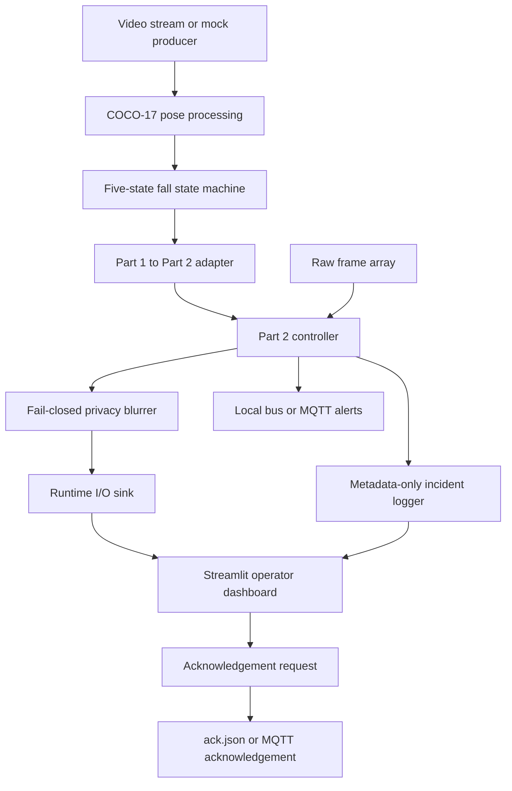

# CRAFTIFAI: FallGuard AI

**Privacy-preserving fall-monitoring pipeline and operator dashboard**

[](https://www.python.org/)
[](https://streamlit.io/)
[](LICENSE)
[](#requirements-and-supported-environments)
[](#runtime-modes)

FallGuard AI is a research and demonstration project exploring how
fall-event monitoring can be combined with privacy-preserving image
handling. It connects a temporal fall-state machine to a fail-closed
blur pipeline, metadata-only incident records, alert messaging, and a
Streamlit operator dashboard.

> **Current status:** The documented workflow runs in simulation mode.
> Live camera inference and production deployment require additional
> hardware/runtime integration and validation. This is not a certified
> medical device or a substitute for caregiver supervision.

## Contents

-   [At a glance](#at-a-glance)
-   [Why FallGuard AI](#why-fallguard-ai)
-   [Features](#features)
-   [Architecture and data flow](#architecture-and-data-flow)
-   [Technology stack](#technology-stack)
-   [Repository structure](#repository-structure)
-   [Requirements](#requirements)
-   [Installation](#installation)
-   [Run the integration simulation](#run-the-integration-simulation)
-   [Launch the dashboard](#launch-the-dashboard)
-   [Run tests](#run-tests)
-   [Privacy model](#privacy-model)
-   [Incident logging and
    acknowledgements](#incident-logging-and-acknowledgements)
-   [Example incident record](#example-incident-record)
-   [Privacy audit results](#privacy-audit-results)
-   [Troubleshooting](#troubleshooting)
-   [Limitations and roadmap](#limitations-and-roadmap)
-   [Safety disclaimer](#safety-disclaimer)

## At a glance

  ---------------------------------------------------------------------
  Area                               Purpose
  ---------------------------------- ----------------------------------
  Fall-state tracking                Uses a five-state temporal state
                                     machine to track possible and
                                     confirmed fall events

  Privacy processing                 Blurs person regions and falls
                                     back to full-frame blur or frame
                                     dropping when safeguards fail

  Incident records                   Writes whitelisted scalar metadata
                                     rather than raw image data

  Alerts                             Supports local messaging and
                                     MQTT-based status/alert messages

  Operator UI                        Displays current state, input
                                     health, privacy-protected
                                     previews, incident history, and
                                     acknowledgement controls

  Testing                            Includes unit/integration tests
                                     and an automated privacy-audit
                                     tool
  ---------------------------------------------------------------------

## Why FallGuard AI

Video monitoring in elder-care and assisted-living settings can expose
highly personal footage. FallGuard AI explores a privacy-by-design
approach: perform fall-state analysis, prevent raw frames from reaching
downstream sinks, and keep incident history focused on operational
metadata.

The pipeline is designed around four principles:

1.  **Privacy before output:** downstream image sinks accept verified
    blurred-frame objects rather than raw frames.
2.  **Fail closed:** when required metadata, bounding boxes, camera
    health, or blur processing cannot be trusted, the system uses
    full-frame blur or drops the frame.
3.  **Metadata-only incident history:** incident records use a strict
    allowlist of fields.
4.  **Operator oversight:** the dashboard provides event visibility and
    acknowledgement controls, while remaining an assistive prototype
    rather than an autonomous safety system.

## Features

-   **Five-state temporal fall logic:** `normal`, `possible_fall`,
    `confirmed_fall`, `recovering`, and `unknown`, with temporal
    validation and hysteresis.
-   **Fail-closed privacy blurring:** `FailClosedBlurrer` applies
    regional pixelation when valid person boxes and camera status are
    available, and falls back to full-frame blur when necessary.
-   **Frame-drop protection:** if blur processing raises an exception,
    the pipeline drops the frame instead of forwarding an unblurred
    image.
-   **Metadata-only JSONL logging:** `IncidentLogger` validates records
    against an allowlist and writes incident history to JSON Lines.
-   **Local and MQTT messaging:** `LocalBus`, `MqttBus`, and alert
    publishing support status and fall-event messages, including topics
    such as `care/room1/status` and `care/room1/fall`.
-   **Streamlit operator dashboard:** current-state cards, evidence
    metrics, input-health indicators, blurred preview, incident history,
    and acknowledgement controls.
-   **Privacy audit tooling:** `fallguard_part2/tools/privacy_audit.py`
    exercises failure scenarios such as blur exceptions, missing
    metadata, bounding-box issues, and camera loss.

## Architecture and data flow



**Flow summary**

1.  Part 1 processes pose/state information and produces a
    `FrameStatus`.
2.  The adapter converts the status into a Part 2 `StateMessage`.
3.  Part 2 coordinates frame blurring, incident logging, messaging, and
    runtime status updates.
4.  The runtime sink writes status and the privacy-protected preview for
    the dashboard.
5.  Operators can review incident history and submit an acknowledgement.

## Technology stack

-   **Language:** Python 3.10+
-   **Computer vision and numerical processing:** OpenCV
    (`opencv-python-headless`), NumPy
-   **Dashboard:** Streamlit 1.28+
-   **Messaging:** Paho-MQTT 1.6+
-   **Testing:** pytest 7+
-   **Potential production target:** NVIDIA Jetson/Linux with TensorRT,
    DeepStream Python bindings (`pyds`), and GStreamer. These components
    are not required for the CPU-based simulation.

## Repository structure

``` text
CRAFTIFAI/
├── part1/                          # Perception and fall-state logic
│   ├── contract.py                 # FrameStatus dataclass and FallState enum
│   ├── fallguard/
│   │   ├── fallguard.py            # Processing loop and event logging
│   │   ├── state_machine.py        # Five-state temporal state machine
│   │   └── watchdog.py             # Staleness and frame-cadence monitoring
│   ├── pipegen/                    # Pipeline IR, ONNX models, TensorRT compiler
│   ├── tests/                      # Part 1 tests
│   └── sample-input.jsonl          # Replayable metadata traces
└── fallguard_part2/                # Privacy, incidents, integration, dashboard
    ├── config/                     # JSON configuration
    ├── dashboard/
    │   └── app.py                  # Streamlit operator dashboard
    ├── privacy/                    # Privacy audit reports and documentation
    ├── src/fg2/
    │   ├── adapter.py              # Part 1 -> Part 2 status adapter
    │   ├── alerts.py               # MQTT alert publisher
    │   ├── app.py                  # Part 2 controller pipeline
    │   ├── blur.py                 # Fail-closed privacy blurring
    │   ├── bus.py                  # LocalBus and MqttBus
    │   ├── contract.py              # StateMessage schema and validation
    │   ├── incident_log.py         # Metadata-only JSONL logger
    │   ├── mock_source.py          # Synthetic stream generator
    │   └── runtime_io.py           # Runtime status and acknowledgement I/O
    ├── tools/
    │   └── privacy_audit.py        # Automated privacy audit runner
    ├── tests/                      # Part 2 unit and integration tests
    ├── run_integration.py          # End-to-end integration simulation
    ├── run_mock.py                 # Standalone mock runner
    └── requirements.txt             # Python dependencies
```

## Requirements and supported environments

-   Python 3.10 or later
-   Ubuntu 20.04, 22.04, 24.04+, or another compatible Linux
    distribution for the documented Linux workflow
-   Windows 10/11 or macOS may also be used for CPU development where
    dependencies are supported
-   A CPU is sufficient for simulation, the Streamlit dashboard, and
    tests

## Runtime modes

### CPU simulation and development

The CPU workflow uses mock feeds, synthetic frames, and metadata traces.
It does not require an NVIDIA GPU.

### Production GPU target

The target accelerated deployment uses an NVIDIA Linux environment,
typically an Ubuntu-based container with GPU passthrough and compatible
host drivers. TensorRT, DeepStream SDK (`pyds`), GStreamer, and
PyGObject (`gi`) must be installed in versions compatible with the
selected NVIDIA platform. These production dependencies are not
installed by `fallguard_part2/requirements.txt`.

> **Important:** A successful CPU simulation does not mean that live GPU
> inference is configured or production-ready.

## Installation

Run these commands from the **repository root**.

### 1. Create and activate a virtual environment

**Ubuntu/Linux**

``` bash
python3 -m venv .venv
source .venv/bin/activate
```

If the `venv` module is unavailable on Ubuntu, install it with your
distribution's package manager, commonly
`sudo apt install python3-venv`, then retry.

### 2. Install Python dependencies

``` bash
python -m pip install --upgrade pip
python -m pip install -r fallguard_part2/requirements.txt
```

### 3. Configure Python import paths

Run this in the same terminal session where you will launch the
application:

``` bash
export PYTHONPATH=".:part1:fallguard_part2/src"
```

If you open another terminal, activate the virtual environment and
export `PYTHONPATH` again.

### Optional: Windows commands

**PowerShell**

``` powershell
python -m venv .venv
.\.venv\Scripts\Activate.ps1
python -m pip install --upgrade pip
python -m pip install -r fallguard_part2/requirements.txt
$env:PYTHONPATH=".;part1;fallguard_part2/src"
```

**Command Prompt**

``` cmd
python -m venv .venv
call .venv\Scripts\activate.bat
python -m pip install --upgrade pip
python -m pip install -r fallguard_part2/requirements.txt
set PYTHONPATH=.;part1;fallguard_part2/src
```

## Run the integration simulation

With the virtual environment active and `PYTHONPATH` configured, run
from the repository root:

``` bash
python fallguard_part2/run_integration.py
```

The simulation uses synthetic frames and metadata traces to exercise the
integrated pipeline. Runtime artifacts may include:

-   `runtime/status.json`
-   `runtime/latest_blurred.jpg`
-   `runtime/incidents/incidents.jsonl`

These are generated runtime outputs and may be recreated when the
simulation runs.

## Launch the dashboard

Keep the integration simulation running in one terminal. In a **second
terminal**, change to the repository root, activate the virtual
environment, set `PYTHONPATH` again, and launch:

``` bash
source .venv/bin/activate
export PYTHONPATH=".:part1:fallguard_part2/src"
streamlit run fallguard_part2/dashboard/app.py
```

Then open <http://localhost:8501>.

The dashboard is intended to show the current fall state, input/camera
health, evidence metrics, blurred preview, incident history, and
acknowledgement controls.

## Run tests

With the virtual environment active and `PYTHONPATH` configured, run
from the repository root:

``` bash
python -m pytest -v part1/tests
python -m pytest -v fallguard_part2/tests
```

To run both suites in one command:

``` bash
python -m pytest -v part1/tests fallguard_part2/tests
```

## Privacy model

The privacy boundary is enforced in `fallguard_part2/src/fg2/blur.py`
and the runtime sink.

-   **Regional blur:** valid person bounding boxes can receive localized
    pixelation when camera status is healthy.
-   **Full-frame blur:** missing/invalid boxes or camera faults trigger
    full-frame blur.
-   **Drop on processing failure:** if the blur operation fails, the
    frame is dropped (`None`) rather than forwarded.
-   **Sink validation:** sinks call `require_blurred()` and reject raw
    NumPy image arrays.
-   **Incident allowlist:** logs and alerts are restricted to approved
    scalar metadata fields.

These are design and test claims for this prototype, not a guarantee of
anonymity under every camera, lighting, resolution, or deployment
condition. Validate privacy on the actual target hardware and footage
before any real-world use.

## Incident logging and acknowledgements

`IncidentLogger` records state transitions and incident lifecycle events
in JSONL format. The documented flow opens incidents on `possible_fall`
or `confirmed_fall` and closes them when the state returns to `normal`.

The logger's allowlist includes fields such as:

`event`, `incident_id`, `ts`, `ts_iso`, `state`, `reason`,
`evidence_score`, `track_id`, `frame_id`, `model`, `runtime`, and
`operator_action`.

Unapproved keys and non-scalar values are rejected with a
`PrivacyError`.

The dashboard acknowledgement action writes an acknowledgement request
to `ack.json` or publishes an MQTT message on `care/room1/ack`. **Known
integration limitation:** the Part 1 state-machine consumer must be
explicitly wired to consume acknowledgements for automatic re-arming in
a production pipeline.

## Example incident record

A representative JSONL incident record may look like this:

``` json
{
  "event": "incident_opened",
  "incident_id": "inc_example_001",
  "ts": 1792355990.0,
  "ts_iso": "2026-10-18T20:39:50Z",
  "state": "confirmed_fall",
  "reason": "Trunk angle exceeded threshold with low torso movement",
  "evidence_score": 0.92,
  "track_id": 1,
  "frame_id": 142,
  "model": "coco17_pose_resnet50",
  "runtime": "simulation_cpu"
}
```

This is an illustrative example, not a record from a live monitored
person.

## Privacy audit results

The project notes report that `fallguard_part2/tools/privacy_audit.py`
was run against 1,728 frames across eight failure scenarios. The
recorded report lists the following outcomes:

  -----------------------------------------------------------------------
  Audit check          Reported evidence             Result in report
  -------------------- ----------------------------- --------------------
  Raw frame not        1,728 frames; raw-frame       Pass
  emitted              equality count: 0             

  Person regions       1,342 person frames; frames   Pass
  sufficiently         retaining at least 15%        
  obscured by the      neighbour pixel detail: 0     
  audit metric                                       

  Blur crash produces  43 injected blur crashes; no  Pass
  no output            image/video flags left behind 

  Camera loss never    22 simulated camera-loss      Pass
  shown clean          frames; none shown unblurred  

  Raw frames rejected  Direct                        Pass
  by sink              `write_latest(raw_ndarray)`   
                       calls rejected with           
                       `PrivacyError`                

  Expected output      `ack.json`,                   Pass
  files only           `incidents.jsonl`,            
                       `latest_blurred.jpg`,         
                       `status.json`, plus temporary 
                       files                         

  No raw videos or     No raw `.mp4`, `.avi`, or     Pass
  unmasked images in   unmasked `.jpg` files         
  output folders       reported                      

  Saved preview is     `latest_blurred.jpg` decoded  Pass
  blurred              and was the only image        
                       artifact                      

  Incident records are Records contained allowlisted Pass
  metadata-only        scalar fields                 

  MQTT alerts are      Alerts followed the           Pass
  metadata-only        allowlisted schema            

  Stale status         Missing, 10-second-old, and   Pass
  handling             fresh status cases            
                       distinguished                 

  Part 2 test suite    44/44 tests passed in 6.74    Pass
                       seconds                       
  -----------------------------------------------------------------------

These figures are transcribed from the project's documented audit report
and are not an independent re-run. See `PRIVACY_TEST_REPORT.md` and the
files under `fallguard_part2/privacy/` for the project evidence.

## Troubleshooting

### `ModuleNotFoundError: No module named 'fg2'` or `part1`

Make sure you are at the repository root, your virtual environment is
active, and `PYTHONPATH` is set in the current terminal.

PowerShell:

``` powershell
$env:PYTHONPATH=".;part1;fallguard_part2/src"
```

### The dashboard does not load or cannot find project modules

Run Streamlit from the repository root rather than from inside
`fallguard_part2/dashboard/`. Confirm dependencies were installed into
the active virtual environment.

### The dashboard reports stale status

Start or restart the integration simulation:

``` powershell
python fallguard_part2/run_integration.py
```

Confirm that `runtime/status.json` is being updated and that the
dashboard is reading the same runtime directory.

### `streamlit` is not recognized

Activate the virtual environment and reinstall the requirements if
needed:

``` powershell
python -m pip install -r fallguard_part2/requirements.txt
```

## Limitations and roadmap

-   **Simulation-first implementation:** the documented local workflow
    uses synthetic CPU frames and generated keypoint traces. Live NVIDIA
    TensorRT/DeepStream/GStreamer inference requires additional
    integration.
-   **Acknowledgement consumption:** automatic state-machine re-arming
    requires an acknowledgement consumer to be wired into the Part 1
    loop.
-   **Real-world privacy validation:** test pixelation against the
    actual cameras, resolutions, viewing conditions, and likely failure
    modes before deployment.
-   **Operational validation:** measure false positives, missed falls,
    latency, availability, and recovery behavior using an appropriate,
    ethically approved evaluation process.
-   **Production hardening:** document deployment configuration,
    monitoring, access controls, retention policies, and
    incident-response procedures before real-world use.

## Safety disclaimer

FallGuard AI is an assistive prototype and research demonstration. It is
**not** a certified medical device, clinical diagnostic tool, or
validated emergency alarm. Do not rely on it as the sole mechanism for
fall detection, patient monitoring, or emergency response. Maintain
appropriate direct supervision and professional caregiver oversight.

------------------------------------------------------------------------

*Developed for CRAFTIFAI · Micro-Hack / FallGuard AI Initiative*
